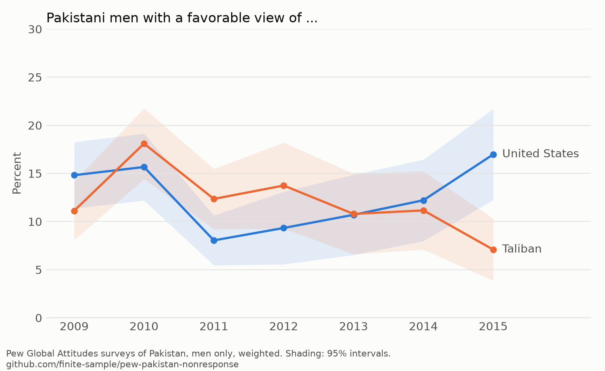

# Who Stopped Answering?

Pew's annual surveys of Pakistan are the standard source on how Pakistanis view the Taliban, al Qaeda, and the United States, and their year-to-year changes are reported as shifts in opinion: "Pakistani Public Opinion Ever More Critical of U.S." (2012), "U.S. Ratings Somewhat Less Negative" and "Extremists Seen Negatively, but Less So in Recent Years" (2014). Respondent-level data from the seven surveys of Pakistan between 2009 and 2015 (Pakistan is not in Pew's spring surveys after 2015) show that these shifts mostly track how many women answered.

- **Women's non-response swings; men's does not.** Women giving no answer about the United States: 26, 26, 21, 12, 27, 48, 22% across 2009 to 2015. Men: 6 to 10% every year. The Taliban, al Qaeda, China, and Iran move with it. Almost every woman rates Nawaz Sharif.
- **The same women.** In 2014, 28% of women answered none of five questions (Taliban, al Qaeda, United States, China, Iran); among men, never more than 1%.
- **The reported trends move with it.** Unfavorable views of the United States peaked at 80% in 2012 and fell to 59% in 2014; among men, 85% and 80%. Men's unfavorable views of the Taliban: 74% in 2009, 75% in 2014. Men's views of al Qaeda did soften.
- **Interviewers.** Women are interviewed by women (99% in 2010), and women's non-response varies across interviewers far more than chance allows.
- **Not education, not coverage, not Pew-wide.** The rise occurs within schooling groups; coverage was constant from 2012 to 2014; among 23 countries surveyed in 2009 and 2014, only Pakistan shows a rise confined to women.

Among men, favorable views of the Taliban and of the United States run neck and neck:



The report is [ms/report.pdf](ms/report.pdf). `uv run python scripts/plot_men.py` redraws the charts in `figs/`.

## Reproducing

Pew's terms do not allow redistributing their data, so `data/raw/` is not in the repository. The summary tables in `results/` are, so the report builds without the raw files.

```sh
make install   # uv sync
make report    # results/ -> tabs/
make paper     # tabs/ -> ms/report.pdf
make check     # lint, tests, tables current, PDF builds with no undefined references
```

To rebuild `results/` from the raw files, create a free account at [pewresearch.org/global/datasets](https://www.pewresearch.org/global/datasets/), download the Spring 2009 through Spring 2015 Global Attitudes datasets, unzip each into `data/raw/<year>/`, and run `make aggregate`.

## Layout

```text
pakdk/data.py       Read Pew files; harmonize items; code answers as positive, negative, or no answer
pakdk/analysis.py   Weighted shares, same-respondent and interviewer analyses, education standardization, cross-country comparison
scripts/run.py      aggregate (raw -> results/) and report (results/ -> tabs/)
tests/              Answer coding, weighting, standardization, and agreement with Pew's published 2014 figures
results/            Committed summary tables
tabs/               Generated LaTeX tables and number macros
ms/                 Report source, bibliography, and PDF
```

## License

Code and report are MIT-licensed. Pew data are subject to Pew Research Center's terms of use.
